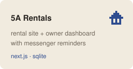
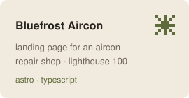
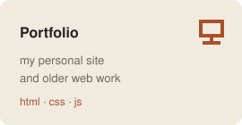

<picture>
  <source media="(prefers-color-scheme: dark)" srcset="assets/hero-dark.svg">
  
</picture>

  

  

<picture>
  <source media="(prefers-color-scheme: dark)" srcset="assets/bookshelf-dark.svg">
  
</picture>

  

<a href="https://github.com/usad-labs/house-rental-system"><picture><source media="(prefers-color-scheme: dark)" srcset="assets/card-rentals-dark.svg"></picture></a>
<a href="https://github.com/usad-labs/bluefrost-aircon"><picture><source media="(prefers-color-scheme: dark)" srcset="assets/card-bluefrost-dark.svg"></picture></a>
<a href="https://2asb2.github.io/Banas_WebPortfolio/"><picture><source media="(prefers-color-scheme: dark)" srcset="assets/card-portfolio-dark.svg"></picture></a>

  

I'm part of **[USAD Labs](https://github.com/usad-labs)**, a small software startup for SMEs in the Philippines. With my friends, we build POS, booking, inventory, payroll, websites and AI automation.

 

<picture>
  <source media="(prefers-color-scheme: dark)" srcset="assets/footer-dark.svg">
  
</picture>

